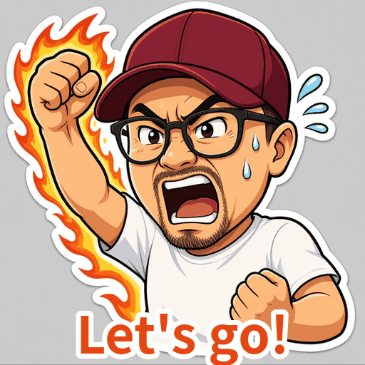
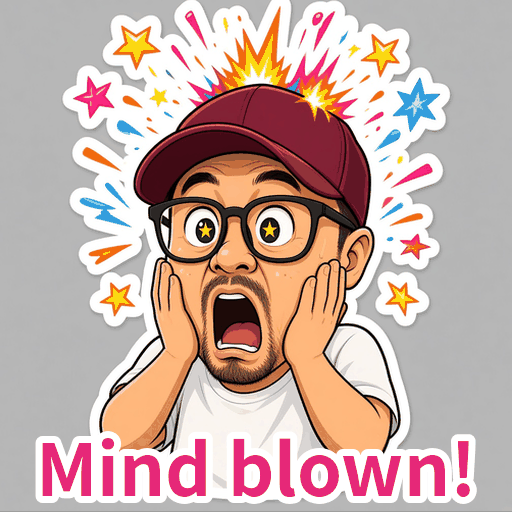
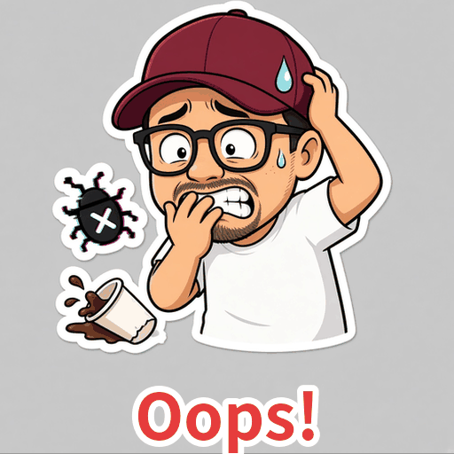
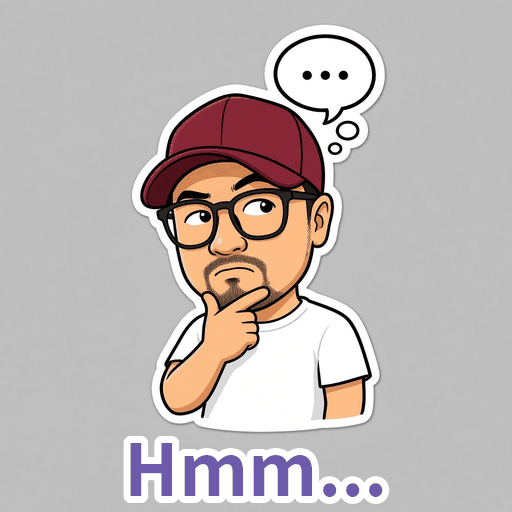

# Photo → Cartoon GIF Stickers

An AI-agent skill that turns **one photo** into a set of **exaggerated cartoon caricature GIF stickers** with a consistent look, ready for X, Discord, Slack or WeChat.

| | | | |
|:-:|:-:|:-:|:-:|
|  |  |  |  |
|  |  |  |  |

## How it works

1. **Lock the identity.** Pick 3–4 anchors from the photo (cap, glasses, beard…) and repeat them in every prompt.
2. **One style line everywhere.** Thick outlines, flat bright colors, big head / small body, white sticker border, 1:1.
3. **Frame A.** Generate the scene from the photo (outfit, props, the joke).
4. **Frame B.** Generate again using Frame A as the only reference, changing just the pose and expression (calm → panic, relaxed → flexing).
5. **Animate with Pillow.** A small bob on A, a hold, then a shaky, red-flashing B: 512×512, 128-color palette, looping, about 1–2 MB.

The full, agent-readable recipe is in [`SKILL.md`](SKILL.md).

## Use it

Drop `SKILL.md` into your agent's skills folder (Claude Code, Cursor, Grok Bot or any agent that reads `SKILL.md` skills), then ask:

> Make me a "Debugging..." GIF sticker from this photo.

You need an image model that accepts a reference image, plus Python with Pillow.

## Notes

- Only use photos of yourself or of people who agreed.
- Example stickers are of the author ([@icebakbum](https://x.com/icebakbum)) and are shared for demonstration only.

## License

MIT
